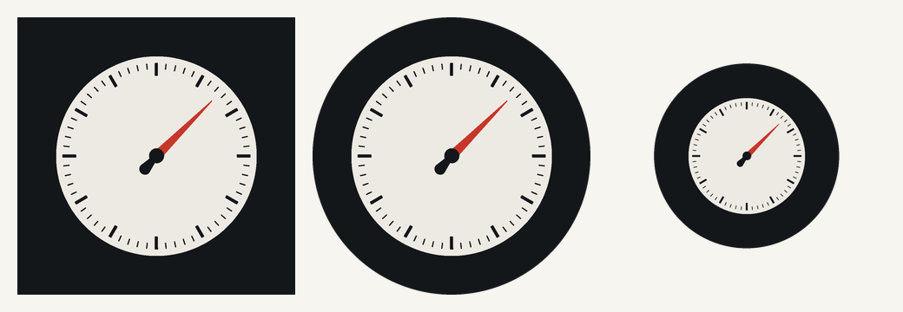

# 疾点 · Jidian

**Android 精密连点器。** 用无障碍手势跨应用点击，用悬浮窗框选落点，节奏、双击、长按、
滑动和随机偏移都可调。界面是一块按下去的计时码表：象牙表盘、石墨墨线、一根信号红秒针。

> 目标系统：Android 8.0 – Android 17（API 26–37）；`compileSdk 36` / `targetSdk 35` / `minSdk 26`。



## 功能

- **跨应用连点**：无障碍 `dispatchGesture` 派发，切到任何 App 都生效，不需要 Root。
- **速度可调**：间隔 1 ms – 10 s，读数可直接点开输入毫秒数；≤16 ms 是「极限档」，
  目标 1000 次/秒，实测能跑多快由系统手势注入上限决定，仪表区实时显示实际频率。
- **四种动作**：单击 / 双击 / 长按 / 滑动（滑动距离、时长、方向可调）。
- **落点手柄**：屏幕上直接显示半透明点击区域，按住中心拖到哪就点到哪；
  运行时手柄自动让触摸穿透，连点不会点在框上。区域大小仍可用「悬浮窗框选」拖出。
- **随机范围**：在落点区域内随机采样 + 额外像素偏移，避免同一像素被反复命中。
- **悬浮控制盘**：52dp 石墨圆盘（视觉约 46dp）。**轻点立即启停**，没有延时也没有「点太慢不认」的判定；
  拖动期间窗口临时铺满全屏、只移动画面内容，**不逐帧重排窗口**，所以跟手不卡；
  长按展开快调面板，面板底部是通栏「停止连点」大按钮；通知栏 / 快捷设置磁贴也能一键开关。
  拖动圆盘时若连点正在运行，会先暂停、松手自动恢复，避免全屏拖动窗口误接触发的点击。
- **前台服务常驻**：切换应用、锁屏再回来都不掉；熄屏自动暂停，亮屏继续。
- **极致性能**：独立 HandlerThread + `dispatchGesture` 回调链 + `postAtTime` 对齐；
  **合并连点**把 1–10 次点击压进同一条手势，摊薄单次派发的 5–7 ms 往返；
  双击合成一条手势（一次 IPC），热路径零锁零分配。
- **稳定性兜底**：手势回调看门狗、无障碍断线自愈、点击上限、诊断计数（超时/自愈/丢弃）。
- **不联网**：App 没有 `INTERNET` 权限，不读屏、不上传任何数据。

## 下载

- 最新 Release：[github.com/3511440694huang-oss/jidian/releases](https://github.com/3511440694huang-oss/jidian/releases)
- 当前版本：`jidian-1.0.2.apk`（6.4 MB）
- SHA-256：`e7ca7682cc49654f2e9bf1aec4b46e7f05f8c86e7181266613cd0d84cd9bd726`

## 安装

1. 下载 `jidian-1.0.2.apk`。
2. 手机上允许「安装未知来源应用」，安装。
3. 依次开启三项权限（App 内每项都有直达按钮）：
   - **无障碍服务**：设置 → 无障碍 → 已安装的服务 → 疾点 → 开启。
     疾点只用它派发手势，**不读取屏幕内容**，配置里 `canRetrieveWindowContent=false`。
   - **悬浮窗**：设置 → 应用 → 疾点 → 显示在其他应用上层。
   - **通知**：允许通知（前台服务通知，可随时停止连点）。
4. 建议把疾点加入电池优化白名单，避免系统在后台冻结它。

## 用法

1. 打开悬浮窗（App 顶栏「悬浮控制台」）。
2. 拖动圆盘到不挡操作的位置；屏幕上的半透明落点框按住中心即可拖动定位。
3. 需要改区域大小时，长按圆盘 →「框选落点」，拖出椭圆/矩形后确认。
4. 在 App 里调节奏、动作模式、随机偏移；回到目标 App，**轻点圆盘开始**，再轻点就停。
5. 还有其他停止入口：长按圆盘 → 面板底部「停止连点」；通知栏「停止」；快捷设置磁贴。

## 参数口径

| 参数 | 范围 | 说明 |
|---|---|---|
| 间隔 | 1 – 10 000 ms | 两次点击之间的间隔；≤16 ms 为极限档 |
| 双击间隔 | 20 – 400 ms | 双击两下之间的时间 |
| 长按时长 | 120 – 2 000 ms | 按住多久算长按 |
| 滑动 | 距离 ≤ 2000 px，时长 60 – 3000 ms | 从落点起按方向滑出 |
| 随机偏移 | 0 – 300 px | 在落点区域内随机抖动 |
| 节奏抖动 | 0 – 80 % | 间隔随机浮动，避免机械节拍 |
| 合并连点 | 开 / 关 | 把一批点击压进一条手势；关掉则每次点击单独派发 |
| 点击上限 | 0 – 1 000 000 | 0 = 不限 |

## 技术要点

- **手势链**：`HandlerThread("tap-engine")` + `GestureResultCallback` 里排下一枪，
  用 `SystemClock.uptimeMillis()` + `postAtTime` 对齐目标时刻，不积累漂移。
- **双击合一**：一个 `GestureDescription` 里放两个 `StrokeDescription`（startTime 0 与 gap），
  双击只要一轮无障碍 IPC。
- **随机采样**：圆内用 `sqrt(u)` 均匀采样，矩形均匀采样，最后 clamp 到屏幕内。
- **看门狗**：2.5 s 内没收到手势回调就判定卡死 → 清状态、记一次自愈、重排；不会把引擎卡死。
- **熄屏暂停**：屏幕熄灭自动停（可关），亮屏后可一键继续。
- **前台服务**：`specialUse` 类型前台服务承载悬浮窗，不依赖 Activity 存活。
- **极限节奏**：间隔 ≤16 ms 时触点时长压到 1 ms；**合并连点**用 `GestureDescription`
  的多 Stroke（系统上限 10 个）把 1–10 次点击放进一次派发，批次总跨度限制在 48 ms 内，
  既摊薄往返开销，停止时也最多残留几十毫秒；实际速率以状态区「实际频率」为准。
- **悬浮窗拖动**：按住圆盘开始拖时把窗口临时铺满全屏，圆盘内容按手指的屏幕绝对坐标移动，
  拖动期间零 `updateViewLayout`，松手才缩回 52 dp；不再有「窗口追触摸」的反馈抖动。
- **落点手柄**：停止状态下整窗可拖动（拖到哪点哪）；连点时整窗 `FLAG_NOT_TOUCHABLE`，
  注入的点击直接穿过手柄落到目标 App，不会点在框上。

## 从源码构建

```bash
# 需要 JDK 17 + Gradle 8.11.1 + Android SDK 36 + build-tools 35
# build.sh 会自动识别 Debian proot 与 Termux/Bionic 两套工具链
bash build.sh :app:assembleRelease   # 产物 app/build/outputs/apk/release/app-release.apk
bash build.sh :app:testDebugUnitTest # 单元测试（几何采样 / 节奏护栏）
```

签名文件在 `keystore/jidian.keystore`（仅用于本项目自发布，不入库）。

## 构建信息

- 版本：1.0.2（versionCode 3）
- 签名证书 SHA-256：`7492b1c017585af88441ad0ddccf788ba179c0f387f48cb76968bad158518af9`
- APK SHA-256：`e7ca7682cc49654f2e9bf1aec4b46e7f05f8c86e7181266613cd0d84cd9bd726`
- 单元测试：23/23 通过（`GeometryTest` 17 + `ClickConfigTest` 6）
- 图标进包校验：5 档密度的 launcher / round / foreground 与 1.0.0 逐字节一致
  （1.0.0 已判定 PASS-EXACT），monochrome 为 PASS-CLEANUP

## 更新日志

### 1.0.2
- **修复：悬浮圆盘拖动不跟手。** 拖动改为「窗口临时全屏 + 只移动画面内容」：
  拖动过程不再逐帧 `updateViewLayout`，位移直接按手指的屏幕绝对坐标算，
  松手才缩回 52 dp 落位。圆盘和落点手柄共用这套拖动。
- **新增：合并连点。** 1 ms 档实测只有 ~150 次/秒，瓶颈是每次 `dispatchGesture` 约 5–7 ms 的往返；
  现在把 1–10 次点击压进同一条手势（批次跨度 ≤48 ms），并把触点压到 1 ms。
  目标应用对多点触控敏感时可在「节奏」里关掉。
- **拖动安全兜底。** 拖圆盘时若连点正在运行，先暂停、松手自动恢复；避免全屏拖动窗口
  把注入的点击接走（拖到一半被误触停掉）。
- **新增：半透明落点手柄。** 屏幕上直接显示点击区域（椭圆/矩形），按住拖到目标上即可定位，
  不再需要进框选模式；运行时手柄整窗不可触摸，点击直接落到目标 App。
- 主界面「落点」增加手柄开关；框选仍保留用于调整区域大小。

### 1.0.1
- **修复：开连点后停不下来。** 圆盘轻点改为**立即启停**（去掉 300 ms 延时，也去掉「按压超过
  180 ms 就当没点」的判定）；长按面板新增通栏「停止连点 / 启动连点」大按钮；从主界面启动时
  自动拉起悬浮控制台并提示停止入口。
- **修复：悬浮窗偏大、拖动发涩。** 圆盘 64dp → 52dp（视觉约 46dp），刻度 60 → 12 根，
  去掉常驻脉冲动画（只在状态变化时重绘一次），拖动位移按帧合并。
- **新增：极限速度。** 节奏下限 10 ms → 1 ms，读数可直接点开输入；滑杆改对数刻度；
  ≤16 ms 时触点时长自动压到 1 ms，实际频率实时显示。
- 面板重新排版（212×132dp）：间隔 ± 步进按 1/2/5/10… 阶梯走，1 ms 也能一档一档调。

## 隐私

- 无网络权限，无统计 SDK，无广告。
- 无障碍服务只调用 `dispatchGesture`；不订阅窗口内容、不截屏、不读输入。
- 所有配置只存在本机 SharedPreferences。

## 许可

[MIT](LICENSE) · 字体 [Barlow](https://github.com/google/fonts/tree/main/ofl/barlow) 与
[IBM Plex Mono](LICENSE-IBM-Plex-Mono.txt) 均为 SIL Open Font License 1.1。
